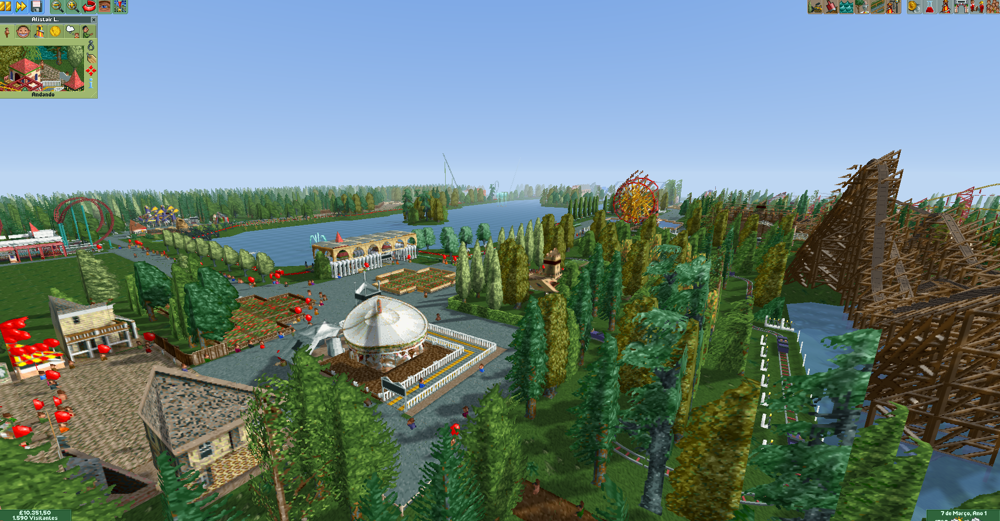
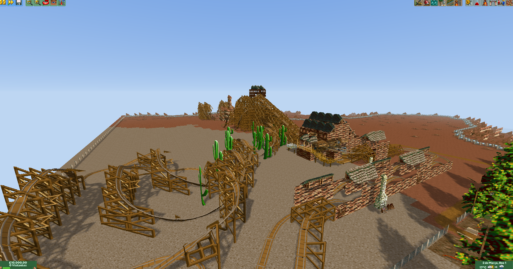
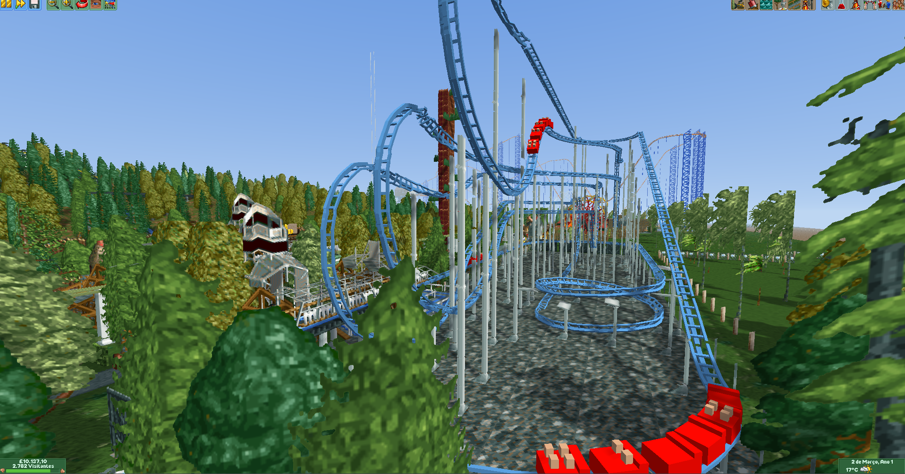

# RCT23D

## English

An experimental 3D visualization mode for **OpenRCT2**, the open-source reimplementation of **RollerCoaster Tycoon 2**. This repository builds on OpenRCT2 and adds a 3D camera mode: the original OpenRCT2 engine continues to simulate the park, while an OpenGL renderer reconstructs the scene from the terrain, map elements, and sprites already painted by the game.

> This project does not include proprietary RollerCoaster Tycoon 2 files. You need a legitimate copy of the game and must point OpenRCT2 to its data files to play.

### Project status

The 3D mode is under development on this branch. It adds free-fly and first-person cameras, an onboard ride camera, terrain and water rendering, objects reconstructed from existing sprites, shadows, field-of-view and draw-distance controls, and switching back to the isometric interface. Availability and performance depend on the computer's OpenGL support.

The default shortcut for switching views is **F6**. The 3D view settings window lets you adjust field of view, movement speed, mouse sensitivity, draw distance, and visual options. Shortcuts can be changed in OpenRCT2's settings.

### Screenshots

<p align="center">
  
  
  
</p>
<p align="center">Park overview · Western themed area · Coaster view</p>

### Requirements

- Windows 10/11, Linux, or macOS compatible with OpenRCT2 requirements.
- CMake 3.24 or newer and a C++20-compatible compiler. On Windows, use Visual Studio 2022 with the **Desktop development with C++** workload.
- OpenRCT2 build dependencies, including SDL2 and OpenGL. See the official platform-specific instructions for installing dependencies and configuring vcpkg where needed.
- A legitimate RollerCoaster Tycoon 2 installation for the game data. Game data is not distributed in this repository.

### Installing to play

1. Get a build of this project or build it using the instructions below.
2. Install RollerCoaster Tycoon 2 from a legitimate store such as Steam or GOG.
3. Start OpenRCT2 and, on first launch, select the folder containing the RCT2 files when prompted. If needed, configure this path in OpenRCT2's directory options.
4. Load a park and press **F6** to switch between the isometric and 3D views.
5. Open the 3D view settings to adjust the camera and graphics options.

For detailed dependency installation and platform-specific setup, see the official [Building OpenRCT2](https://github.com/OpenRCT2/OpenRCT2/wiki/Building-OpenRCT2) guide.

### Building from source

Clone the repository and initialize its submodules:

```bash
git clone https://github.com/Fabiusmaia/RCT23D.git
cd RCT23D
git submodule update --init --recursive
```

Install and configure the dependencies as described in the official guide for your platform. Then configure and build with CMake. Example for Windows with Visual Studio 2022:

```powershell
cmake -S . -B build -G "Visual Studio 17 2022" -A x64
cmake --build build --config Release
```

Example for Linux or macOS using the default generator:

```bash
cmake -S . -B build -DCMAKE_BUILD_TYPE=Release
cmake --build build --parallel
```

These configuration commands assume that OpenRCT2's required dependencies are already available. Some platforms or configurations use a vcpkg toolchain file; follow the official platform guide for the correct parameters for your setup. Output locations and installation steps vary by operating system and CMake generator.

### Architecture

The 3D mode is integrated into OpenRCT2's existing flow to reuse its simulation, map elements, palette, and game graphics.

```text
OpenRCT2 simulation and map
        │
        ├── PaintCapture: records sprites emitted by the isometric painter
        ├── SceneBuilder: builds terrain, water, track, objects, and entities
        ├── Camera3D / Render3D: camera, movement modes, and feature state
        └── Renderer3D (OpenGL): textures, meshes, shaders, shadows, and composition
                    │
                    └── 3D framebuffer composited underneath the normal game UI
```

#### Main components

- `src/openrct2/render3d/`: rendering-independent 3D logic. Includes camera and math, painter output capture, scene types, and terrain, sprite, track, and entity construction. `WalkCollision` handles collision and walkable surfaces for first-person mode.
- `src/openrct2-ui/drawing/engines/opengl/Renderer3D.*`: graphics backend. Builds and maintains map-chunk meshes, creates a texture atlas from game sprites, applies shaders and shadows, and composites the result into a framebuffer.
- `data/shaders/render3d*`: scene and sky shaders used by the renderer.
- `src/openrct2-ui/windows/View3DSettings.cpp`: camera and 3D-mode settings window.
- `src/openrct2-ui/input/` and `src/openrct2-ui/WindowManager.cpp`: shortcut, mouse, and interaction switching between the 2D viewport and 3D camera.
- `src/openrct2/config/Config.*`: persistence for camera and view options.
- `test/tests/Render3DTests.cpp`: unit tests for geometry and scene-building logic that can be checked without drawing the interface.

The scene is partitioned into chunks so geometry can be built and updated as the map changes. Sprites are captured from the game's four isometric view rotations and used as the basis for reconstructing objects in the 3D scene. This lets much of the original content appear without replacing RCT2 assets.

### Controls

- **F6**: switch between isometric and 3D views.
- **Mouse**: look around when the 3D camera controls the main viewport.
- **Mouse wheel**: adjusts movement or zoom, depending on the camera mode.
- **WASD and the movement controls configured in the game**: navigate the camera; bindings use OpenRCT2 movement actions.
- **3D view settings**: switch between free-fly and first-person cameras, invert the vertical axis, smooth sprites, enable shadows, and follow the nearest ride vehicle.

Exact keyboard bindings may vary by language, shortcut configuration, and camera mode. Check the in-game shortcut settings.

### Known limitations

- 3D reconstruction uses sprites and data from the isometric painter, so some objects may not look like native 3D models.
- The view depends on the OpenGL renderer and may turn itself off if graphics initialization fails.
- Rendering cost varies with park size, draw distance, graphics hardware, and hardware support for shadows.
- The 3D mode is a work in progress on top of OpenRCT2. When reporting an issue, include the operating system, graphics hardware, and reproduction steps.

### Contributing

Open an issue describing the problem, your operating system, and reproduction steps when possible. To propose changes, create a branch and submit a pull request. Read [CONTRIBUTING.md](CONTRIBUTING.md) and the OpenRCT2 build instructions before getting started.

### License and credits

The code is licensed under GNU GPL v3 or later, as described in [licence.txt](licence.txt). OpenRCT2 is an independent reimplementation of RollerCoaster Tycoon 2; credits and contributors are listed in [contributors.md](contributors.md). RollerCoaster Tycoon 2 belongs to its respective rights holders; this repository does not distribute the game or its proprietary data.

### Links

- [RCT23D repository](https://github.com/Fabiusmaia/RCT23D)
- [Original OpenRCT2 project](https://github.com/OpenRCT2/OpenRCT2)
- [Official build guide](https://github.com/OpenRCT2/OpenRCT2/wiki/Building-OpenRCT2)
- [OpenRCT2.io](https://openrct2.io/)

---

## Português

Uma implementação de visualização 3D para o OpenRCT2, projeto de código aberto que reimplementa **RollerCoaster Tycoon 2**. Este repositório parte do código do OpenRCT2 e acrescenta um modo de câmera 3D ao jogo: o parque continua sendo simulado pelo motor original do OpenRCT2, enquanto um renderizador OpenGL reconstrói a cena a partir do terreno, dos elementos do mapa e dos sprites que o jogo já pinta.

> O projeto não inclui os arquivos proprietários de RollerCoaster Tycoon 2. Para jogar, é necessário possuir uma cópia legítima do jogo e indicar seus arquivos ao OpenRCT2.

## Estado do projeto

O modo 3D está em desenvolvimento nesta branch. A implementação adiciona câmera livre e em primeira pessoa, câmera a bordo de veículos, renderização de terreno e água, objetos derivados dos sprites existentes, sombras, controles de distância e campo de visão e alternância para a interface isométrica. A disponibilidade e o desempenho dependem do suporte a OpenGL do computador.

Atalho padrão para alternar a visualização: **F6**. A janela de configurações do modo 3D permite ajustar campo de visão, velocidade, sensibilidade, distância de desenho e opções visuais. Os atalhos podem ser alterados nas configurações do OpenRCT2.

### Capturas de tela

<p align="center">
  
  
  
</p>
<p align="center">Visão geral do parque · Área temática de velho oeste · Montanha-russa</p>

## Requisitos

- Windows 10/11, Linux ou macOS compatível com os requisitos do OpenRCT2.
- CMake 3.24 ou superior e compilador C++20 compatível. No Windows, use Visual Studio 2022 com a carga de trabalho **Desenvolvimento para desktop com C++**.
- Dependências de compilação do OpenRCT2, incluindo SDL2 e OpenGL. Consulte as instruções oficiais da sua plataforma para instalar as dependências e configurar o vcpkg quando necessário.
- Uma instalação legítima de RollerCoaster Tycoon 2 para obter os dados do jogo. Os dados não são distribuídos por este repositório.

## Instalação para jogar

1. Obtenha uma compilação deste projeto ou compile-o seguindo a seção abaixo.
2. Instale RollerCoaster Tycoon 2 por uma loja legítima, como Steam ou GOG.
3. Abra o OpenRCT2 e, na primeira execução, informe a pasta que contém os arquivos do RCT2 quando solicitado. Se necessário, configure o caminho nas opções de diretórios do OpenRCT2.
4. Carregue um parque e pressione **F6** para alternar entre a câmera isométrica e a visualização 3D.
5. Abra as configurações da visualização 3D para ajustar a câmera e as opções gráficas.

Para instruções detalhadas de instalação de dependências e configuração específica por sistema operacional, consulte [Building OpenRCT2](https://github.com/OpenRCT2/OpenRCT2/wiki/Building-OpenRCT2).

## Compilar a partir do código-fonte

Clone o repositório e inicialize os submódulos:

```bash
git clone https://github.com/Fabiusmaia/RCT23D.git
cd RCT23D
git submodule update --init --recursive
```

Instale e configure as dependências conforme o guia oficial da plataforma. Em seguida, gere a compilação com CMake. Exemplo para Windows com Visual Studio 2022:

```powershell
cmake -S . -B build -G "Visual Studio 17 2022" -A x64
cmake --build build --config Release
```

Exemplo para Linux ou macOS usando o gerador padrão:

```bash
cmake -S . -B build -DCMAKE_BUILD_TYPE=Release
cmake --build build --parallel
```

Os comandos de configuração pressupõem que as dependências exigidas pelo OpenRCT2 já estão disponíveis no ambiente. Algumas plataformas ou configurações usam um arquivo de toolchain do vcpkg; siga o guia oficial para obter os parâmetros corretos para sua instalação. A saída e a etapa de instalação variam conforme o sistema e o gerador CMake utilizado.

## Arquitetura

O modo 3D foi integrado ao fluxo existente do OpenRCT2 para reutilizar a simulação, os elementos do mapa, a paleta e o conteúdo gráfico do jogo.

```text
Simulação e mapa do OpenRCT2
        │
        ├── PaintCapture: captura os sprites emitidos pelo pintor isométrico
        ├── SceneBuilder: constrói terreno, água, trilhos, objetos e entidades
        ├── Camera3D / Render3D: câmera, modos de movimento e estado do recurso
        └── Renderer3D (OpenGL): texturas, malhas, shaders, sombras e composição
                    │
                    └── framebuffer 3D composto sob a interface normal do jogo
```

### Componentes principais

- `src/openrct2/render3d/`: lógica independente de renderização OpenGL. Inclui câmera e matemática 3D, captura da saída do pintor, tipos de cena e construção de terreno, sprites, trilhos e entidades. `WalkCollision` calcula colisões e superfícies para o modo em primeira pessoa.
- `src/openrct2-ui/drawing/engines/opengl/Renderer3D.*`: backend gráfico. Constrói e mantém malhas por blocos do mapa, prepara atlas de texturas a partir dos sprites, aplica shaders e sombras e compõe o resultado em um framebuffer.
- `data/shaders/render3d*`: shaders de cena e céu usados pelo renderer.
- `src/openrct2-ui/windows/View3DSettings.cpp`: janela de opções da câmera e do modo 3D.
- `src/openrct2-ui/input/` e `src/openrct2-ui/WindowManager.cpp`: integração de atalhos, mouse e alternância de interação entre o viewport 2D e a câmera 3D.
- `src/openrct2/config/Config.*`: persistência das opções da câmera e da visualização.
- `test/tests/Render3DTests.cpp`: testes unitários para as partes de geometria e construção da cena que podem ser validadas sem desenhar a interface.

O cenário é particionado em blocos para construir e atualizar a geometria conforme o mapa muda. Os sprites são capturados nas quatro rotações isométricas do jogo e usados como base para reconstruir objetos na cena 3D. Assim, grande parte do conteúdo original pode ser exibida sem substituir os assets do RCT2.

## Controles

- **F6**: alterna entre a vista isométrica e a vista 3D.
- **Mouse**: olha ao redor quando a câmera 3D controla o viewport principal.
- **Roda do mouse**: ajusta o movimento/zoom conforme o modo da câmera.
- **WASD e controles de movimento configurados no jogo**: navegação da câmera; os vínculos usam as ações de movimento do OpenRCT2.
- **Configurações da vista 3D**: alterna câmera livre/primeira pessoa, inverte o eixo vertical, suaviza sprites, ativa sombras e permite acompanhar o veículo mais próximo.

Os vínculos exatos de teclado podem variar com o idioma, a configuração de atalhos e o modo da câmera. Consulte os atalhos dentro do jogo.

## Limitações conhecidas

- A reconstrução 3D aproveita sprites e dados do pintor isométrico, então a aparência de alguns objetos pode não corresponder a modelos 3D nativos.
- A vista depende do renderer OpenGL e pode ser desativada automaticamente se a inicialização gráfica falhar.
- O custo de renderização varia com o tamanho do parque, a distância de desenho, a placa de vídeo e a disponibilidade de sombras por hardware.
- O modo 3D é uma contribuição em desenvolvimento sobre o OpenRCT2; problemas específicos devem ser relatados com o sistema operacional, hardware gráfico e passos para reproduzir.

## Como contribuir

Abra uma issue descrevendo o problema, o sistema operacional e, quando possível, os passos para reproduzi-lo. Para propor mudanças, crie uma branch e envie um pull request. Consulte [CONTRIBUTING.md](CONTRIBUTING.md) e as instruções de compilação do OpenRCT2 antes de começar.

## Licença e créditos

O código segue a licença GNU GPL v3 ou posterior, conforme [licence.txt](licence.txt). O OpenRCT2 é uma reimplementação independente de RollerCoaster Tycoon 2 e seus créditos e colaboradores estão listados em [contributors.md](contributors.md). RollerCoaster Tycoon 2 é propriedade de seus respectivos titulares; este repositório não distribui o jogo nem seus dados proprietários.

## Links

- [Repositório RCT23D](https://github.com/Fabiusmaia/RCT23D)
- [Projeto OpenRCT2 original](https://github.com/OpenRCT2/OpenRCT2)
- [Guia oficial de compilação](https://github.com/OpenRCT2/OpenRCT2/wiki/Building-OpenRCT2)
- [OpenRCT2.io](https://openrct2.io/)
